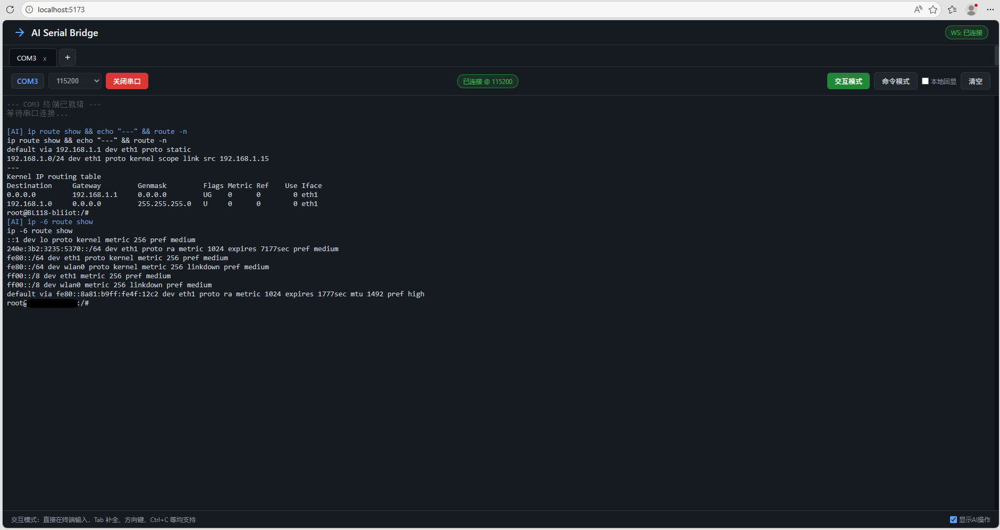
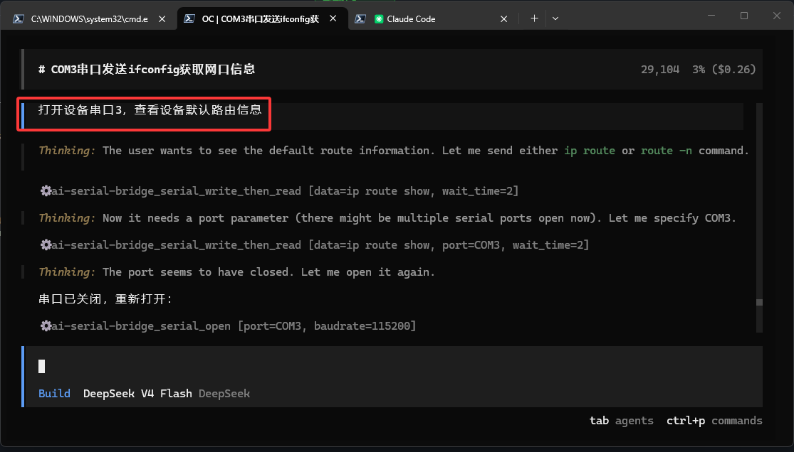

# AI Serial Bridge

[](https://python.org)
[](https://vuejs.org)
[](https://fastapi.tiangolo.com)
[](https://modelcontextprotocol.io)
[](LICENSE)

[English](README.md) | **中文**

让 AI Agent 拥有双手，直接控制物理世界中的串口设备。

## 什么是 AI Serial Bridge？

AI Serial Bridge 是一个基于 **Model Context Protocol (MCP)** 的桥接服务器，它将 AI 编程助手（Claude、Cursor、Cline、Continue、Kimi Code 等）与物理串口设备连接起来。它让你的 AI 从一个纯文本助手变成一个能够感知硬件的智能体——可以打开串口、发送命令、读取设备返回、实时诊断问题。

你可以把它理解为 **带 AI 大脑的 MobaXterm**——既保留了熟悉的终端界面供手动调试，又能让 AI 通过自然语言自主与硬件交互。

## 解决了什么问题？

### 1. AI 无法触碰物理硬件
传统的 AI 助手只能在数字世界运作——它们可以写代码、分析日志、给出修复建议，但无法与物理设备直接交互。当你的嵌入式系统在野外崩溃时，AI 只能告诉你*可能哪里出了问题*，却无法*亲自去检查*。

### 2. 嵌入式调试繁琐且重复
开发者每天花费大量时间在重复的串口操作上：
- 用 PuTTY / Tera Term 手动连接 COM 口
- 一遍又一遍地输入相同的诊断命令
- 把设备输出复制粘贴到 ChatGPT 里分析
- 为了调试一个问题要在 5 个工具之间来回切换

### 3. 远程设备维护困难重重
当设备部署在现场、而你在办公室时，调试意味着：
- VPN + 远程桌面 + 串口透传隧道的层层套娃
- 电话指挥现场人员逐字念十六进制转储
- 为了跑一个 `ifconfig` 或 `dmesg` 来回折腾数小时

### 4. 没有 AI 控制串口的标准方式
每个 AI 工具（Claude、Cursor、Cline...）都有自己的插件体系。没有通用协议让 AI 控制硬件，每次集成都要写定制代码。

## AI Serial Bridge 如何解决？

| 之前 | 之后 |
|------|------|
| AI 建议你"查看一下串口日志" | AI **自己打开串口**读取日志 |
| 你手动输入 `ping www.baidu.com` | AI 发送命令并**把结果整理成表格** |
| 复制粘贴十六进制转储到 ChatGPT | AI 通过 MCP **实时分析设备输出** |
| 一个人、一个终端、一台设备 | **多端口并行、AI + 人类协作**、Web UI 全员可见 |

### 核心设计决策

- **MCP stdio 传输**：兼容任何支持 MCP 的 AI 代理，无需定制插件
- **HTTP 代理架构**：MCP Server 不直接持有硬件，而是代理到共享的 FastAPI 后端，Web UI 和 AI 始终看到同一设备状态
- **WebSocket 实时同步**：AI 通过 MCP 打开 COM3，浏览器标签页立即出现；你在浏览器关闭标签，AI 立刻知道端口已释放
- **双模式终端**：交互模式（按键透传，像 MobaXterm 一样）供人工控制；命令模式（底部输入栏）供 AI 脚本化操作

## 应用场景

### 嵌入式固件开发
向 STM32 / ESP32 烧录固件、读取启动日志、调整寄存器值——全部用自然语言完成。"把新固件烧到 COM3，告诉我传感器是否正常初始化。"

### IoT 设备远程诊断
现场部署的树莓派或工业网关断网了。AI 通过串口连接，运行 `ip route`、`dmesg`、`systemctl status` 定位根因，无需任何人到现场。

### 工业自动化（PLC / RTU）
监控通过 Modbus/RS-485 连接的 PLC。AI 读取线圈状态、写入保持寄存器、自动生成状态报告。

### 网络设备配置
通过 Console 口配置路由器、交换机和防火墙。AI 应用配置模板、用 `ping` 验证连通性、失败时自动回滚。

### 硬件测试与 QA
自动化硬件在环测试。AI 发送测试命令、校验返回值是否符合预期、生成通过/失败报告。

### 教育与原型开发
学生用自然语言与 Arduino 或 Micro:bit 对话学习嵌入式系统，无需记忆 AT 指令语法。

## 功能

- **AI 直接控制串口**：MCP 提供 19 个串口控制、租约、历史、传输和自动化工具
- **单写者保护**：一个客户端持有可续期写租约，其他 Web UI 与 MCP 客户端保持只读观察
- **无损 Hex 管线**：Hex 显示与导出使用精确原始接收块，完整保留 CR/LF 和任意二进制字节
- **Web UI 终端**：基于 xterm.js，支持语法高亮、滚动回溯、完整 ANSI 转义序列
- **交互模式**：点击终端直接输入——Tab 补全、方向键、Ctrl+C 中断，与 MobaXterm 体验一致
- **命令模式**：底部输入栏，支持选择换行符模式（CR / LF / CRLF），适合脚本化操作
- **本地回显开关**：设备不回显时开启，避免盲打
- **AI 操作日志**：可选在终端中显示 AI 发送的命令，带 `[AI]` 标签，全程透明
- **多标签多端口**：同时打开 COM3、COM4、COM5——每个端口独立终端会话
- **AI 与 Web UI 自动同步**：AI 打开端口 → 浏览器出现标签页；你关闭标签 → AI 知道端口已释放
- **通信历史**：每个端口的完整收发日志，标注来源（用户 / AI / 设备 / 系统）
- **安全浏览器会话**：可选主 token 只用于换取短期 HttpOnly 会话，并校验 WebSocket Origin
- **带流控的文件发送**：二进制文件按块确认发送，支持进度显示与取消
- **XMODEM/YMODEM 传输**：支持 CRC/校验和协商、ACK/NAK 重试、取消和设备确认完成
- **持久轮转日志**：可搜索的 JSONL 文本/原始字节日志跨重启保留并按大小轮转
- **串口参数档案**：按硬件 ID 记忆数据格式、流控、DTR 和 RTS
- **HWID 自动重连**：命名档案可在 COM 号变化后按退避策略恢复连接
- **协议接收**：Web UI 与 MCP 可接收 XMODEM/YMODEM 文件并支持取消
- **YMODEM 批量接收**：批量接收为 ZIP，并生成带 SHA-256 的 `manifest.json`；MCP 写入前会校验文件
- **日志会话**：持久记录包含会话 ID，并支持可选的按天保留策略
- **加密日志**：可选使用 Fernet 加密新写入的轮转日志
- **租约防护**：阻止多个客户端交错写入，并允许其他客户端安全只读观察
- **设备自动化**：通过 Web UI 或 MCP 配置有界命令宏、正则健康规则和遵守租约的定时诊断
- **离线密钥轮换**：支持明文日志迁移、Fernet 密钥轮换、dry-run、原子替换、备份和回滚
- **服务管理器**：一键启动/停止/重启整个技术栈（后端 + 前端）

## 截图

**Web UI** - 实时串口终端，支持交互模式与命令模式  


**AI Agent** - 通过串口进行网络诊断（ping + 路由）  


## 架构

```
AI Agent --MCP/stdio--> mcp_server.py --HTTP--> main.py --USB--> 串口设备
                                              |
Web UI --WebSocket--> main.py(FastAPI) -------+
```

MCP Server 不直接持有串口硬件，而是通过 HTTP 代理到 `main.py`，与 Web UI 共享同一个串口状态。因此必须先启动后端服务，MCP 才能正常工作。

## 快速开始（推荐）

AI Serial Bridge 当前通过源码安装，不是 PyPI 软件包。运行环境需要 Python 3.10+、Node.js 20+ 和 npm。

```bash
git clone https://github.com/jingza1024/AI_Serial_Bridge.git
cd AI_Serial_Bridge
python -m venv .venv
```

PowerShell 激活命令：

```powershell
.\.venv\Scripts\Activate.ps1
```

Linux/macOS 激活命令：

```bash
source .venv/bin/activate
```

```bash
# 安装 Web 后端、MCP 代理和前端依赖
python -m pip install --upgrade pip
python -m pip install -r backend/requirements.txt -r backend/requirements-mcp.txt
cd frontend
npm ci
cd ..

# 启动所有服务（后端 + 前端）
python manager.py start

# 查看状态
python manager.py status

# 停止所有服务
python manager.py stop

# 重启所有服务
python manager.py restart
```

`start` 会占用当前终端（类似 `docker-compose up`），后台和前端的日志会交错输出。按 **Ctrl+C** 一次即可优雅停止所有服务。

启动后访问：http://localhost:5173

## 安装配置

根据运行目标选择依赖：

| 配置 | 安装命令 | 额外步骤 |
|------|----------|----------|
| Web 后端 | `python -m pip install -r backend/requirements.txt` | 构建或启动 Vue 前端 |
| MCP 客户端代理 | `python -m pip install -r backend/requirements-mcp.txt` | 使用 MCP SDK 1.x，仍需启动 Web 后端 |
| 桌面 GUI | `python -m pip install -r backend/requirements-desktop.txt` | 在 `frontend/` 执行 `npm ci && npm run build` |
| 开发 / 打包 | `python -m pip install -r backend/requirements-dev.txt` | 包含后端、MCP、桌面、pytest 和 PyInstaller |

### 桌面 GUI

桌面壳加载生产前端资源，启动前需要先构建：

```bash
python -m pip install -r backend/requirements-desktop.txt
cd frontend
npm ci
npm run build
cd ..
python desktop.py
```

首次启动时，桌面模式会在 `~/.ai-serial-bridge/credentials.json` 创建用户级凭据并持续复用。活动回环地址写入不含 token 的 `runtime.json`，已注册的 MCP 代理可自动发现桌面重启和端口变化。显式 `AI_SERIAL_TOKEN` 会覆盖默认配对，此时也必须传给 MCP 进程。

源码模式下，如果 Vue 源码或构建配置比 `frontend/dist` 更新，`desktop.py` 会拒绝加载旧资源并提示执行 `cd frontend && npm run build`。交互终端默认向 Linux 控制台发送 LF，并在每个终端提供 CRLF/CR 换行选项，以兼容不同串口设备的 Enter 语义。

### 构建桌面发行版

```bash
python -m pip install -r backend/requirements-dev.txt
cd frontend
npm ci
npm run build
cd ..
python -m PyInstaller ai-serial-bridge.spec
```

onedir 产物位于 `dist/AI Serial Bridge/`。桌面发行版不内置 MCP stdio 代理；请在源码目录安装 MCP 依赖，并让 AI 客户端运行 `backend/mcp_server.py`。

如果打包后的桌面程序启动后立即关闭，可临时将 `ai-serial-bridge.spec` 中的 `console=False` 改为 `console=True`，重新打包后从 PowerShell 启动，以查看后端错误。正常发布 GUI 版本时请恢复为 `console=False`。

## 手动启动

### 1. 安装依赖

```bash
# 从仓库根目录执行
python -m pip install -r backend/requirements.txt
cd frontend
npm ci
cd ..
```

### 2. 启动后端

```bash
cd backend
python main.py
```

后端运行在 http://localhost:8000

### 3. 启动前端

在仓库根目录打开第二个终端：

```bash
cd frontend
npm run dev
```

访问: http://localhost:5173

### 可选鉴权

启动后端前设置 `AI_SERIAL_TOKEN`。Web UI 首次连接时会要求输入该 token，并换取 HttpOnly 浏览器会话；`/api/config` 不会返回主 token。

```bash
# PowerShell
$env:AI_SERIAL_TOKEN="replace-with-a-random-secret"
python manager.py start
```

MCP 进程需要设置相同环境变量。若服务监听回环地址以外的接口，请使用 TLS 反向代理并显式配置 `CORS_ORIGINS`。详见 [SECURITY.md](SECURITY.md)。

### 离线日志迁移与密钥轮换

执行前先停止后端。目标密钥只放在 `AI_SERIAL_LOG_KEY`；轮换时将旧密钥放在 `AI_SERIAL_LOG_OLD_KEY`，先 dry-run 再执行：

```bash
python scripts/rotate_log_key.py --dry-run
python scripts/rotate_log_key.py
```

CLI 不接受命令行密钥，也不会打印密钥。每个日志文件旁会保留迁移备份。附带的只读 Linux 实机检查命令为：

```bash
python scripts/test_hardware_automation.py --port <PORT> --baudrate 115200
```

## MCP 配置

> **前提条件**: 安装 `backend/requirements-mcp.txt`，并在 Agent 客户端中一次性注册 `backend/mcp_server.py`。随后启动桌面程序、`python backend/main.py` 或 `python manager.py start`。

MCP 代理在每次请求前解析当前桌面地址和凭据；独立后端默认使用 `http://127.0.0.1:8000`。仅在显式独立或远程目标中设置 `AI_SERIAL_API_URL` 和 `AI_SERIAL_TOKEN`。回环请求会自动绕过环境代理；远程 URL 可使用代理，但绝不会收到本地保存的凭据。

当前代理使用 MCP SDK 1.x API（`mcp>=1.0.0,<2.0.0`）。请在 MCP 客户端实际使用的同一个虚拟环境中安装 `backend/requirements-mcp.txt`。下面各配置中的 `python` 只是占位符：如果客户端不会继承已激活的虚拟环境，请改成解释器绝对路径，例如 Windows 的 `C:\\path\\to\\AI_Serial\\.venv\\Scripts\\python.exe`，或 Linux/macOS 的 `/path/to/AI_Serial/.venv/bin/python`。可直接参考 `mcp-config/` 下的配置模板。

默认桌面配对不需要环境变量。如果使用显式 token 或远程后端，应使用 MCP 客户端提供的环境变量配置，不要把真实密钥提交到仓库：

```json
{
  "env": {
    "AI_SERIAL_TOKEN": "replace-with-a-secret",
    "AI_SERIAL_API_URL": "https://serial.example.com"
  }
}
```

本地桌面配对通常不需要设置 `AI_SERIAL_API_URL`；远程目标必须显式配置，并应使用 TLS。

以下配置中所有路径均为示例，请将 `<YOUR_PROJECT_PATH>` 替换为你的实际安装目录。

### Kimi Code CLI

> **注意**: Kimi Code **VS Code 扩展**不支持 MCP，只有 **CLI 版本**支持。

配置文件: `~/.kimi/mcp.json` (Windows 路径: `C:\Users\<用户名>\.kimi\mcp.json`)

```json
{
  "mcpServers": {
    "ai-serial-bridge": {
      "command": "python",
      "args": [
        "<YOUR_PROJECT_PATH>/backend/mcp_server.py"
      ]
    }
  }
}
```

使用 CLI 启动时带上配置:

```bash
kimi --mcp-config-file C:\Users\<用户名>\.kimi\mcp.json
```

参考: https://docs.moonshot.cn/kimi-cli/mcp

---

### Claude Desktop

配置文件路径:
- **Windows**: `%APPDATA%\Claude\claude_desktop_config.json`
- **macOS**: `~/Library/Application Support/Claude/claude_desktop_config.json`
- **Linux**: `~/.config/Claude/claude_desktop_config.json`

```json
{
  "mcpServers": {
    "ai-serial-bridge": {
      "command": "python",
      "args": [
        "<YOUR_PROJECT_PATH>/backend/mcp_server.py"
      ]
    }
  }
}
```

保存后**完全退出并重启** Claude Desktop。

参考: https://modelcontextprotocol.io/quickstart/user

---

### Claude Code (CLI)

推荐通过 CLI 命令添加:

```bash
claude mcp add ai-serial-bridge -- python <YOUR_PROJECT_PATH>/backend/mcp_server.py
```

或手动编辑配置文件 `~/.claude/settings.json`:

```json
{
  "mcpServers": {
    "ai-serial-bridge": {
      "command": "python",
      "args": [
        "<YOUR_PROJECT_PATH>/backend/mcp_server.py"
      ]
    }
  }
}
```

参考: https://github.com/anthropics/claude-code/blob/main/MCP.md

---

### Cursor

配置文件路径:
- **全局**: `~/.cursor/mcp.json`
- **项目级**: `.cursor/mcp.json` (项目根目录)

> Cursor 要求显式声明 `"type": "stdio"`。

```json
{
  "mcpServers": {
    "ai-serial-bridge": {
      "type": "stdio",
      "command": "python",
      "args": [
        "<YOUR_PROJECT_PATH>/backend/mcp_server.py"
      ]
    }
  }
}
```

保存后，在 Cursor 设置 > MCP 中确认服务器已加载。

参考: https://cursor.com/docs/mcp

---

### VS Code 内置 Copilot Chat (Agent 模式)

VS Code 原生支持 MCP，适用于 GitHub Copilot Chat Agent 模式。

配置文件路径:
- **工作区级**: `.vscode/mcp.json` (推荐，可纳入版本控制)
- **用户级**: 运行命令 **MCP: Open User Configuration**

> VS Code 使用 `"servers"` 作为顶层键（非 `"mcpServers"`），且必须包含 `"type"` 字段。

```json
{
  "servers": {
    "ai-serial-bridge": {
      "type": "stdio",
      "command": "python",
      "args": [
        "<YOUR_PROJECT_PATH>/backend/mcp_server.py"
      ]
    }
  }
}
```

配置后 VS Code 会提示信任该服务器，确认后即可使用。

参考: https://code.visualstudio.com/docs/copilot/customization/mcp-servers

---

### Cline (VS Code Extension)

配置文件路径:
- **Windows**: `%APPDATA%\Code\User\globalStorage\saoudrizwan.claude-dev\settings\cline_mcp_settings.json`
- **macOS**: `~/Library/Application Support/Code/User/globalStorage/saoudrizwan.claude-dev/settings/cline_mcp_settings.json`
- **Linux**: `~/.config/Code/User/globalStorage/saoudrizwan.claude-dev/settings/cline_mcp_settings.json`

> 如果在 Cursor / Windsurf 中运行 Cline，将路径中的 `Code` 替换为对应编辑器名称。

```json
{
  "mcpServers": {
    "ai-serial-bridge": {
      "command": "python",
      "args": [
        "<YOUR_PROJECT_PATH>/backend/mcp_server.py"
      ],
      "disabled": false,
      "alwaysAllow": []
    }
  }
}
```

也可在 Cline 面板中点击 **MCP Servers** > **Configure MCP Servers** 通过 UI 添加。

参考: https://docs.cline.bot/mcp/adding-and-configuring-servers

---

### Continue.dev (VS Code / JetBrains)

Continue 新版推荐使用 **YAML 配置**:

在项目根目录创建 `.continue/mcpServers/ai-serial-bridge.yaml`:

```yaml
name: ai-serial-bridge
version: 0.0.1
schema: v1
mcpServers:
  - name: ai-serial-bridge
    type: stdio
    command: python
    args:
      - <YOUR_PROJECT_PATH>/backend/mcp_server.py
```

或放入用户级目录 `~/.continue/mcpServers/` 实现全局可用。

旧版 JSON 配置（`~/.continue/config.json`）仍兼容:

```json
{
  "experimental": {
    "modelContextProtocolServers": [
      {
        "transport": {
          "type": "stdio",
          "command": "python",
          "args": [
            "<YOUR_PROJECT_PATH>/backend/mcp_server.py"
          ]
        }
      }
    ]
  }
}
```

> **注意**: MCP 工具仅在 Continue 的 **Agent 模式** 下可用，普通 Chat 模式不会调用工具。

参考: https://docs.continue.dev/customize/deep-dives/mcp

---

### Windsurf (Codeium)

配置文件: `~/.codeium/windsurf/mcp_config.json`

```json
{
  "mcpServers": {
    "ai-serial-bridge": {
      "command": "python",
      "args": [
        "<YOUR_PROJECT_PATH>/backend/mcp_server.py"
      ]
    }
  }
}
```

参考: https://docs.windsurf.com/windsurf/cascade/mcp

---

### OpenCode

配置文件路径:
- **全局**: `~/.config/opencode/opencode.json`
- **项目级**: `opencode.json` (项目根目录，优先级最高)

> OpenCode 的格式与其他工具不同：`"mcp"` 为顶层键，`"type": "local"` 为必需项，`"command"` 为**数组**。

```json
{
  "$schema": "https://opencode.ai/config.json",
  "mcp": {
    "ai-serial-bridge": {
      "type": "local",
      "command": [
        "python",
        "<YOUR_PROJECT_PATH>/backend/mcp_server.py"
      ]
    }
  }
}
```

参考: https://opencode.ai/docs/mcp-servers/

---

### Codex CLI (OpenAI)

配置文件: `~/.codex/config.toml` (Windows: `%USERPROFILE%\.codex\config.toml`)

> Codex 使用 TOML 格式。默认桌面模式只需配置命令和脚本路径。

```toml
[mcp_servers.ai-serial-bridge]
command = "python"
args = ["<YOUR_PROJECT_PATH>/backend/mcp_server.py"]
```

或通过 CLI 添加:

```bash
codex mcp add ai-serial-bridge -- python <YOUR_PROJECT_PATH>/backend/mcp_server.py
```

首次注册或修改 MCP 配置后需重启 Codex 或新建任务；之后桌面重启和端口变化无需再次重载 MCP。可运行 `python scripts/smoke_test_mcp.py` 验证 stdio 初始化与后端连通性。真实 Linux 控制台验证可设置 `AI_SERIAL_TEST_PORT` 后运行 `python scripts/test_linux_serial_mcp.py`；脚本只发送 `printf` 和 `uname`，校验返回后关闭端口。使用 com0com 配对时，可运行 `python scripts/test_xmodem_mcp_loopback.py` 验证完整协议链路。

参考: https://developers.openai.com/codex/mcp

---

### Zed Editor

配置文件:
- **macOS / Linux**: `~/.config/zed/settings.json`
- **Windows**: `%APPDATA%\Zed\settings.json`

> Zed 使用 `"context_servers"` 键（非 `"mcpServers"`），命令结构为嵌套对象。

```json
{
  "context_servers": {
    "ai-serial-bridge": {
      "command": {
        "path": "python",
        "args": ["<YOUR_PROJECT_PATH>/backend/mcp_server.py"],
        "env": {}
      }
    }
  }
}
```

参考: https://zed.dev/docs/ai/mcp

## 使用指南

### Web UI 操作

1. 打开浏览器访问 http://localhost:5173
2. 点击 **+** 设置串口、数据格式、流控、DTR 和 RTS，点击「打开串口」
3. **交互模式**（默认）：直接在黑色终端区域点击并输入，像 MobaXterm 一样使用
   - Enter 发送命令
   - Tab 自动补全
   - 方向键浏览历史
   - Ctrl+C 中断当前程序
   - 右键终端可复制当前选中文本或粘贴剪贴板内容
4. **命令模式**：在底部输入框输入命令发送，可选择换行符模式（CR / LF / CRLF）
5. 观察终端中设备的返回数据
6. 发送文件前选择 **RAW**、**XMODEM**、**XMODEM-1K** 或 **YMODEM**，并先让设备进入对应接收模式
7. 点击标签页上的 **x** 关闭串口并释放资源
8. 点击 header 右上角的 **EN** 按钮可在中英文界面之间切换

### AI Agent 操作

配置好 MCP 后，AI 会自动获得以下工具：

| 工具 | 说明 | 参数 |
|------|------|------|
| `serial_list_ports` | 列出可用串口 | 无 |
| `serial_open` | 使用完整串口参数打开 | `port`(必填)，波特率/数据格式/流控/DTR/RTS |
| `serial_close` | 关闭指定串口 | `port`(单端口时可省略) |
| `serial_write` | 发送数据到串口 | `data`(必填), `port`(单端口时可省略), `newline` |
| `serial_write_then_read` | 发送并等待响应 | `data`(必填), `port`(单端口时可省略), `wait_time` |
| `serial_get_history` | 获取通信历史 | `port`(必填), `limit` |
| `serial_is_open` | 检查串口是否已打开 | `port`(必填) |
| `serial_get_lease` | 查看当前写入者 | `port`(必填) |
| `serial_acquire_lease` | 获取或续期写权限 | `port`(必填), `ttl` |
| `serial_release_lease` | 释放 MCP 写权限 | `port`(必填) |
| `serial_send_protocol_file` | 使用 XMODEM/YMODEM 发送本地文件 | `port`, `file_path`，可选协议/超时 |
| `serial_receive_protocol_file` | 接收 XMODEM/YMODEM 到本地路径 | `port`, `output_path`，可选大小/超时 |
| `serial_receive_ymodem_batch` | 使用 YMODEM 批量接收，校验 SHA-256 并写入清单 | `port`, `output_directory`，可选覆盖/超时 |
| `serial_cancel_transfer` | 取消协议传输 | `transfer_id`(必填) |
| `serial_list_macros` | 列出已配置的命令宏 | 无 |
| `serial_run_macro` | 运行命令宏并返回设备输出 | `port`, `macro_id`，可选 `run_id` |
| `serial_cancel_macro` | 取消当前 MCP 客户端发起的命令宏 | `run_id`(必填) |
| `serial_get_health` | 读取最近的健康规则事件 | 可选 `port`, `limit` |
| `serial_get_diagnostic_schedules` | 列出诊断计划和最近运行状态 | 无 |

> **注意**: 所有涉及操作的工具（write/close/write_then_read）都需要指定 `port`。如果只打开了一个串口，工具会自动推断，无需手动指定。如果同时打开了多个串口，必须明确传入 `port` 参数。

**示例对话:**

> **用户**: 帮我把LED1打开  
> **AI**: 我先连接串口并发送命令...
> ```
> 使用 serial_open(port="COM3")
> 使用 serial_write(data="LED1 ON")
> ```
> 已发送命令，设备返回: `OK\r\nLED1=ON`

## 技术栈

- **Backend**: Python, FastAPI, pyserial, WebSocket
- **Frontend**: Vue 3, TypeScript, Vite, xterm.js
- **Agent协议**: Model Context Protocol (MCP)

## 目录结构

```
AI_Serial/
├── manager.py              # 服务管理器 (start/stop/restart/status)
├── backend/
│   ├── main.py             # FastAPI + WebSocket 服务
│   ├── mcp_server.py       # MCP Server (stdio -> HTTP 代理)
│   ├── local_runtime.py    # 桌面凭据与运行时发现
│   ├── automations.py      # 健康规则、命令宏和计划运行时
│   ├── serial_manager.py   # 多串口管理器
│   ├── leases.py           # 单写者端口租约
│   ├── log_store.py        # 轮转持久 JSONL 日志
│   ├── transfers.py        # XMODEM/YMODEM 状态机
│   ├── requirements.txt    # 后端核心运行依赖
│   ├── requirements-mcp.txt
│   └── requirements-desktop.txt
├── frontend/
│   └── src/
│       ├── App.vue
│       ├── components/
│       │   ├── automation/ # 自动化弹窗和面板
│       │   ├── AuthDialog.vue
│       │   ├── LogBrowserDialog.vue
│       │   ├── LogSessionList.vue
│       │   ├── PortDialog.vue
│       │   ├── TerminalToolbar.vue
│       │   └── TerminalPanel.vue
│       ├── composables/
│       │   ├── useAutomations.ts
│       │   ├── useSerial.ts
│       │   └── useLocale.ts
│       ├── locales/
│       │   ├── zh.ts
│       │   └── en.ts
│       └── styles/
│           └── main.css
├── mcp-config/             # 各 Agent 工具的 MCP 配置示例
│   ├── claude_desktop_config.json
│   ├── claude_code_settings.json
│   ├── cursor_mcp.json
│   ├── vscode_mcp.json
│   ├── cline_mcp_settings.json
│   ├── continue_mcp.yaml
│   ├── continue_mcp_config.json
│   ├── windsurf_mcp_config.json
│   ├── opencode_mcp.json
│   ├── codex_config.toml
│   └── zed_settings.json
├── scripts/
│   ├── rotate_log_key.py           # 离线加密日志迁移
│   └── test_hardware_automation.py # 认证只读 MCP 实机检查
├── assets/
│   └── screenshots/        # 项目截图
├── .github/
│   ├── ISSUE_TEMPLATE/
│   │   ├── bug_report.md
│   │   └── feature_request.md
│   └── PULL_REQUEST_TEMPLATE.md
├── SECURITY.md
├── ROADMAP.md
├── CONTRIBUTING.md
├── LICENSE
├── README.md
└── README.zh-CN.md
```

## 许可证

MIT
